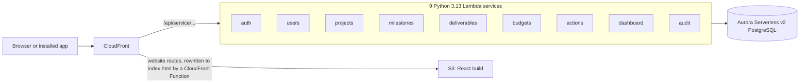

# Throughline: ACME project delivery tracker

Throughline gives ACME one place to see where every project stands: milestones and the dependencies between them, who is booked on what, budget spent against plan, and what needs attention next.

**Live app:** https://d2b668bdid50ni.cloudfront.net

Built by Javier Benitez for the Citi coding workshop (full stack track).

## Try it

The login page has one-click demo buttons. Every account below works on the live site.

| Role | Username | Password | Good things to try |
|---|---|---|---|
| Administrator | `admin` | `Admin123!` | Create projects and people, archive and restore projects, read the audit log |
| Manager | `dana.whitfield` | `Demo1234!` | Reschedule a milestone and watch later ones shift, assign people (8-hour rule), record spending |
| Manager | `marcus.chen` | `Demo1234!` | Branch Kiosk Rollout: at risk, a blocked install, and a vendor delay in the history |
| Employee | `leo.martins` | `Demo1234!` | My work: update the status of your own deliverables |

The database is serverless and pauses when idle, so the first request after a quiet period can take up to 30 seconds. The app retries automatically and says it's waking up.

## The business questions, answered

| Question from the brief | Where the app answers it |
|---|---|
| What is the current status of each active project? | Dashboard portfolio timeline, project cards, and a written status briefing on every project |
| Which projects are at risk of missing their deadlines? | Health score on every project (on track, at risk, off track) with the reasons spelled out, plus a forecast finish date based on the pace so far |
| How are resources allocated across projects? | Workload heatmap: hours booked per person per week against a 40-hour week |
| What are the key deliverables and their completion status? | Milestones tab, My work board, and progress bars that roll up from deliverables |
| Which team members are over-allocated? | The 8-hour daily limit is enforced when booking, and the heatmap and Action Center flag anyone over it |
| What is the dependency chain between deliverables? | Gantt timeline with dependency arrows, the critical path highlighted, and how many days each milestone can slip |
| How much budget has been consumed versus planned? | Budget tab: planned vs spent, burn chart, spending by category, and a forecast at the current pace |

## Requirements checklist

| Requirement | How it's met |
|---|---|
| Admin creates projects for managers | Admin-only New project form. The manager is added to the team automatically |
| Admin creates employees assigned to a manager | Admin-only Add person form. Employees must report to an active manager |
| Admin creates managers and archives projects | Same form with the Manager role. Deleting a project archives it |
| Admin can unarchive projects | Archive page, Restore button |
| One project has one manager, who is on the project | `manager_id` is required, and the manager is always a team member |
| A manager can have multiple projects | Managers see every project they run |
| Managers assign employees to their projects | Team tab, Add people. Employees from any manager's team can join |
| Managers edit only their immediate team | Server checks `manager_id` before any edit. Managers can change name, email and job title |
| Managers adjust the budget | Adjust budget requires a reason and is saved to the history |
| Managers can't delete projects | DELETE by a manager returns 403 |
| Stretch: managers create teams | Not built. Cross-team staffing covers the need (see known gaps) |
| Employees view their projects and update only their name and email | Profile page. The server rejects any other field |
| Employees update deliverable status | My work board and the Milestones tab, only for work assigned to them |
| An employee can work for different managers | Project membership is separate from who they report to |
| An employee can only be on a full 8-hour milestone at a time | Bookings are in hours per day, and no one can exceed 8 on any weekday across all projects |
| Don't delete, archive instead | Projects archive and restore. Deactivated users keep their history |
| Start and end dates; 40-hour weeks | Every project and milestone has dates. Workload uses 8 hours over 5 days |
| Milestones with dependencies and their own dates | Dependencies are enforced, and circular chains are rejected |
| Explain why dates changed ("started late because of X") | Every date change requires a reason and shows in the History tab |
| Option to change dates if they're missed | Reschedule previews every later milestone that has to move, then shifts them together |
| When all milestones are done, the manager closes the project and it's archived | Complete project is enabled only when every milestone is done |
| A status bar | Status stepper on every project, plus progress bars throughout |
| Track what actions need to be taken, and admins see what was done | Action Center (rules open and close items automatically) plus the Audit log |
| Deployed to AWS | Live on CloudFront, S3, Lambda and Aurora PostgreSQL |

## Architecture



**Backend.** One Lambda per resource, each with REST routes (`GET /projects`, `POST /projects`, `PUT /projects/{id}` and so on). Shared code lives once in `backend/_shared/core`: the router, error format, validation, JWT auth, database access, the health score, scheduling logic and the Action Center rules. `bin/sync-shared.sh` copies it into each service before every deploy, so there is no copy-paste in the source, and each Lambda still packages on its own.

**Database.** PostgreSQL. Each service creates any missing tables on its first request, so a fresh AWS database needs no manual setup.

**Frontend.** React 19 with Material UI and React Responsive (sidebar on desktop, bottom navigation on phones), React Router, and TanStack Query for caching and auto-refresh every 30 seconds. Pages load on demand. It installs as an app (manifest, icons and a service worker that never caches API data).

**Security.** Passwords are hashed with PBKDF2. Access tokens last 15 minutes. Refresh tokens rotate on every use, and reusing an old one signs that user out everywhere. Every request reloads the user from the database, so role changes and deactivations apply immediately. Unknown fields are rejected, so no one can send `"role": "admin"` in an update. Resources you can't see return 404, not 403, so IDs can't be probed.

### Data model

`users`, `projects`, `project_members`, `milestones`, `milestone_dependencies`, `milestone_assignments` (hours per day), `deliverables`, `budget_entries`, `budget_changes`, `date_changes` (every reschedule, with its reason), `action_items`, `activity_log` (the audit trail with before and after values) and `refresh_tokens`.

### Roles and permissions

| | Admin | Manager | Employee |
|---|---|---|---|
| See projects | All | The ones they run | The ones they're on |
| Create, reassign, archive, restore projects | Yes | No | No |
| Edit dates, budget, team, milestones | Yes | Their projects | No |
| Update deliverable status | Yes | Their projects | Their own work |
| Create users, change roles | Yes | No | No |
| Edit people | Anyone | Direct reports: name, email, title | Themselves: name and email |
| See budgets | Yes | Their projects | Totals only, not spending entries |
| Audit log | Yes | No | No |

### Business rules worth knowing

- **Health score.** A project is off track if it's past its end date, over budget or has an overdue milestone. It's at risk if it's behind schedule (25+ points less progress than time used), spending faster than it's progressing, has a blocked milestone, or ends within a week below 90% done.
- **Rescheduling.** Moving a milestone pushes later milestones forward just enough to keep their dependencies, keeping each one's length. Completed milestones never move. If that would run past the project's end, the manager can extend the project in the same step, and both changes go into the history with the reason.
- **8-hour day.** Booking checks the busiest weekday across every overlapping milestone on every active project. The refusal says how many hours are free and what the person is already booked on.
- **Critical path and delivery forecast.** The Timeline tab finds the chain of milestones with the least slack, using a backward pass over the dependency graph in reverse topological order (Kahn's algorithm). A delay anywhere on that chain moves the project end date, and every other milestone shows how many days it can slip. The forecast projects the finish date from the pace of work so far, as an early warning rather than a promise.
- **Risk register.** Each project has a Risks tab: risks scored by likelihood and impact (1 to 5 each) on a 5x5 matrix, each with an owner, a mitigation plan, a review date and a status. The app suggests risks from live signals (no buffer on the critical path, a late delivery forecast, spending on pace to overrun), and managers add or dismiss them. Overdue reviews become Action Center items, every change is audited, and employees can read risks but never see budget risks.
- **Ask Throughline.** A chat assistant on every page (or Ctrl+J) that answers plain-English questions from live data: project status, what's at risk, overdue, blocked or due soon, who's overbooked or free, budgets, and "what should I work on?". It also works as built-in support, explaining how to reschedule, assign people, restore projects and more. It is rule-based on purpose: questions are matched to intents, answers come from the same permission-checked queries as the rest of the app, so it can't invent facts or reveal data. answer() is a single entry point, so an LLM such as Claude on Bedrock could slot in later.
- **Action Center.** Rules raise items for overdue projects and milestones, budgets over plan, blocked or overdue work, over-allocated people, milestones ready to start or close, and projects ready to complete. Items close themselves once the problem is fixed and reopen if it comes back. Closing anything by hand requires a note, and every resolution is in the audit log.

## Running it locally

From inside the workshop VDI, after the setup in `docs/validation.md`:

```sh
./bin/start-dev.sh                                   # LocalStack, Postgres, all Lambdas, frontend on :3000
.venv/bin/python scripts/seed_demo.py --reset        # demo data (local only: clears the database first)
```

Open http://localhost:3000. After changing backend code, `bin/sync-shared.sh` runs automatically as part of `deploy-backend.sh`.

## Deploying to AWS

Run from a fresh terminal, so no LocalStack settings leak in:

```sh
./bin/deploy-backend.sh                              # Terraform: Aurora, Lambdas, S3, CloudFront
./bin/deploy-frontend.sh                             # builds React and uploads it
API_URL=https://<cloudfront-domain>/api .venv/bin/python scripts/seed_demo.py
```

## Testing

| Suite | Count | Command |
|---|---|---|
| Backend unit tests (validation, auth, router, health score, scheduling, forecast) | part of 288 | `.venv/bin/pytest tests/backend/unit` |
| Backend integration tests (real API and database, every role and rule) | part of 288 | `.venv/bin/pytest tests/backend/integration` |
| Frontend tests (API client, login journey, briefing, formatting, forms, components) | 60 | `cd frontend && npm test` |
| Load test against the live API | see below | `API_URL=... .venv/bin/python scripts/load_test.py` |

Full output and coverage: [backend](docs/test-results-backend.txt), [frontend](docs/test-results-frontend.txt). Integration tests create their own uniquely named users, so they can run any number of times, and modules that book time use their own employee so the 8-hour rule doesn't make results depend on test order.

### Load test: finding and fixing a bottleneck

20 concurrent users, 15 requests each, through CloudFront against the live API.

| | Before | After | Change |
|---|---|---|---|
| Throughput | 7.5 req/s | 11.7 req/s | +56% |
| Median response, all endpoints | 270 ms | 63 ms | about 4x faster |
| `/actions/summary` median | 1,563 ms | 35 ms | about 45x faster |
| Success rate | 96.0% | 97.7% | 12 failures to 7 |

The dashboard and Action Center refresh the action items before answering, and that refresh waited on a database lock, so under load every request queued behind the others. The fix: if another request is already refreshing, skip it instead of waiting, since that request is about to produce the same result. I also raised Lambda memory from 128 MB to 512 MB, which gives each function about 4 times the CPU. Full tables: [before](docs/load-test-before.md), [after](docs/load-test-after.md).

The remaining slow tail (p95 around 8 seconds) and failures come from bursts of brand-new Lambdas each opening a database connection at the same moment, while the serverless database scales up. The standard fix is RDS Proxy for connection pooling, which isn't part of this workshop's infrastructure.

## Issues found and fixed along the way

In the provided starter code:

1. **The local proxy dropped the `Authorization` header,** so login tokens never reached the backend locally. Fixed in `bin/proxy-server.js`.
2. **The local proxy dropped `Content-Length` and reused connections,** so a DELETE with a body corrupted the next request on that connection. Fixed by forwarding the header and using a fresh connection per request.
3. **The local proxy turned unknown services into a confusing 502** instead of its intended 404, because it built the target URL as `"undefined/..."` before checking.
4. **CloudFront's site-wide 404 rewrite would have replaced real API 404s with the homepage** (with a 200 status), and S3 returns 403, not 404, for missing paths, so refreshing a page like `/projects/3` would fail. Replaced with a CloudFront Function that rewrites only website routes.
5. **LocalStack hot reload runs the service folder as-is,** so Python packages from `requirements.txt` were missing locally. Fixed by vendoring them into a hidden `.vendor` folder that's excluded from the AWS package.

Found by my own tests:

6. Chrome showed `$250.0K` on chart axes while Firefox showed `$250K`. A frontend test caught it, and the fix was an explicit `minimumFractionDigits: 0`.
7. The load test found the action sync lock queue described above.
8. A dashboard test booked the shared test employee for a full day, which made later milestone tests fail depending on run order. Each module that books time now uses its own employee.

## Design decisions and trade-offs

- **One Lambda per resource with shared core code,** rather than one big Lambda: matches the REST-per-resource structure and keeps services independent, at the cost of more cold starts and connections (see the load test).
- **Archive instead of delete** for projects, and deactivate instead of delete for people: history and the audit trail stay intact. Deleting is allowed only for things that never finished, like an unstarted milestone or a spending entry, and those deletions are recorded with their full details.
- **Reasons are required** for every date or budget change and every manually closed action item. That's what makes the history and the audit log useful.
- **Action items are computed by rules on read** instead of a scheduled job. They're always current with no extra infrastructure, at the cost of some work on dashboard loads (now limited to one refresh at a time).
- **Tokens in localStorage** so a page refresh keeps you signed in. The risk is limited by 15-minute access tokens and refresh token rotation with reuse detection. HttpOnly cookies would be stronger but need more CloudFront and CORS configuration.
- **The status briefing is rule-based, not AI.** It's written from the live data with fixed rules, so it's predictable and testable. If an AI model is available (for example Amazon Bedrock, which this account's Lambdas don't have permission for), it could generate the same briefing and power Ask Throughline behind the same API.

## Known gaps and next steps

- **Frontend test coverage is about 16% overall.** The logic everything relies on (API client, briefing, formatting, form state) is at 97 to 100%, but the big pages are tested by hand, not automatically. Next: page tests with a mocked API, and Cypress end-to-end tests for each role's main journey.
- **No end-to-end browser tests yet.**
- **Teams (the stretch goal) aren't built.** The table exists in the schema, and cross-team staffing already works through project membership.
- **The serverless database pauses when idle,** so the first request can be slow. Keeping a minimum capacity or adding RDS Proxy would fix it, at extra cost.
- **npm audit warnings** are in development-only test tools and aren't shipped to users.
- **No real-time push.** Screens refresh every 30 seconds and right after any change, which covers the brief without WebSockets.

## Project structure

```
backend/
  _shared/core/      shared code: router, auth, db, validation, health, scheduling, action rules, schema
  auth/ users/ projects/ milestones/ deliverables/ budgets/ actions/ dashboard/ audit/
frontend/src/
  pages/             one file per screen
  components/        shared UI, plus components/project for the project tabs
  hooks/ utils/ services/api.js
infra/               Terraform (the CloudFront Function fix is in cloudfront.tf)
scripts/             seed_demo.py, load_test.py, generate_icons.py
tests/backend/       unit/ and integration/
docs/                test results, load test results, workshop guides
```